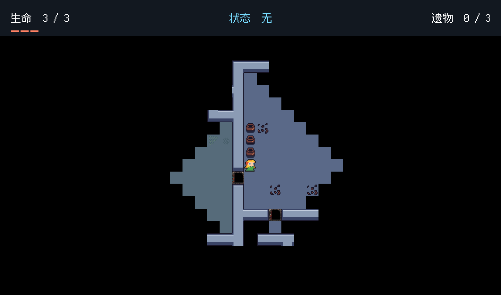

# 地牢探险 · Dungeon Explorer

你只有三点生命，出口还锁着。摸进迷雾，找齐三件遗物，然后活着走出去。每拿一件遗物，地牢里就多一只怪物。等出口打开后，你可以立刻撤离，也可以继续找剩下两件，拿到增益再闯出去。



## 地牢里有什么

- **迷雾和岔路**。走过的房间会留下暗淡的轮廓，前方还要靠近了才看得清。留意窄门和走廊，记住来时的路。
- **五种怪物**。有的会追上来，有的会预判你的去向，也有守住地盘、来回巡逻或见你靠近就逃的。悬停可以看说明。怪物进入喘息时，是越过它的机会。
- **遗物和增益**。第四、第五件遗物才会给增益。根据捡到的遗物，你可能扩大视野、恢复生命、抵挡一次伤害、冻结怪物或获得出口方向提示。
- **沿路的机会**。小心尖刺，受伤时找治愈泉。双向传送门能帮你换条路，祝福宝箱则会给一项随机增益。

## 开始一局

安装 JDK 21 后，在终端执行下面的命令。首次启动会下载 Gradle 和依赖。

```bash
git clone https://github.com/everlastingQAQ/dungeon-explorer.git
cd dungeon-explorer
```

Windows PowerShell

```powershell
.\gradlew.bat :lwjgl3:run
```

Linux 或 macOS

```bash
./gradlew :lwjgl3:run
```

在 WSL 中运行需要 WSLg 或其他图形显示环境。进主菜单后按 `N`，可以先输入 `42` 试一局，再按 `S` 开始。同一版本输入相同的种子会生成相同的初始地牢，方便重走一遍或和朋友比路线。

## 操作

| 场景 | 按键 |
| --- | --- |
| 主菜单 | `N` 新游戏，`L` 读档，`Q` 退出 |
| 输入种子 | 输入数字，`S` 开始，退格删除，`B` 返回 |
| 探索 | `W/A/S/D` 移动，鼠标悬停查看地格、物件或怪物，`P` 暂停 |
| 暂停 | `P` 继续，`S` 保存，`Q` 返回主菜单 |
| 保存或读档 | `1–5` 选槽位，`B` 返回 |
| 覆盖存档 | `Y` 确认，`N` 或 `B` 取消 |
| 胜利或失败 | `N` 再开一局，`Q` 返回主菜单 |

游戏有五个存档槽。读档后，进行中的一局会停在暂停界面，按 `P` 继续。通过 Gradle 启动时，存档在 `assets/save/`。

游戏源自 CS 61B 的 Build Your Own World 项目。[课程说明](https://sp21.datastructur.es/materials/proj/proj3/proj3) · [设计笔记](core/src/DESIGN.md) · [角色与物件素材](assets/sprites/dungeon-ii/ASSET_LICENSE.md) · [地形素材](assets/tilesets/rgs-cc0/README.md)
