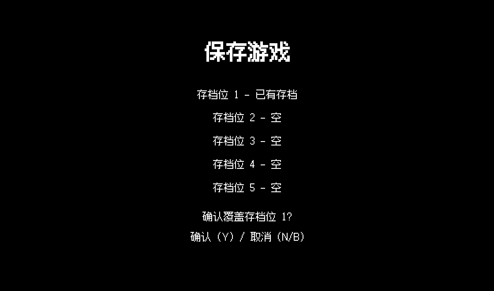
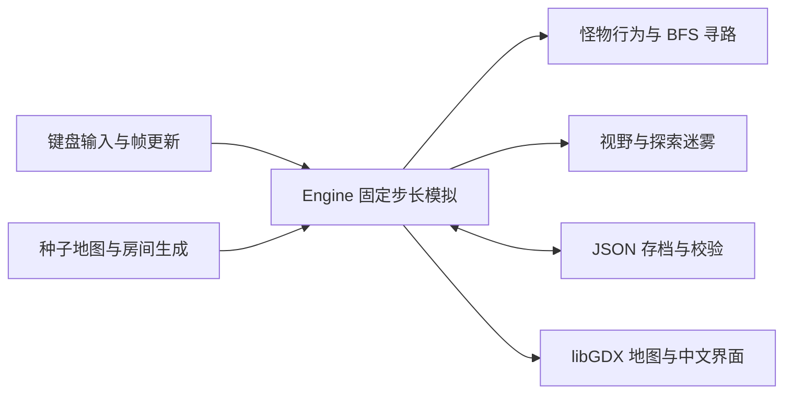

# BYOW 地牢探险

BYOW 是一款用 Java 21 和 libGDX 开发的桌面实时地牢探索游戏，源自 Berkeley CS 61B 的 Build Your Own World 项目。输入种子生成地牢，在迷雾中收集遗物、避开怪物，再从开启的出口逃离。 [课程项目说明](https://sp21.datastructur.es/materials/proj/proj3/proj3)


## 快速开始

安装 JDK 21，并让终端使用该 JDK。项目自带 Gradle Wrapper，首次运行会下载 Gradle 和依赖。

```bash
git clone https://github.com/everlastingQAQ/byow-dungeon-explorer.git
cd byow-dungeon-explorer
```

Windows PowerShell

```powershell
.\gradlew.bat :lwjgl3:run
```

Linux 或 macOS

```bash
./gradlew :lwjgl3:run
```

桌面程序需要图形环境。在 WSL 中运行时需要 WSLg 或其他显示服务。进入主菜单后按 `N`，输入 `42`，再按 `S` 开始探索截图里的地牢。同一版本使用相同种子会生成相同的初始布局。

## 玩法与操作

地图上有五种遗物。每次拾取都会激活对应的怪物，收集任意三件即可开启出口。继续拾取第四、第五件可以获得视野、治疗、出口雷达、护盾或冻结增益。生命归零时游戏失败，活着进入已开启的出口即可获胜。

怪物会实时追踪、伏击、守卫、巡逻或追逃切换。观察喘息和冻结提示可以找准穿过走廊的时机。地牢里还会生成尖刺、治愈泉、双向传送门及随机增益宝箱。

| 场景 | 操作 |
| --- | --- |
| 主菜单 | `N` 开始新游戏，`L` 读档，`Q` 退出程序 |
| 输入种子 | 输入 0～9223372036854775807，`S` 开始，退格删除，`B` 返回 |
| 探索 | 按住 `W/A/S/D` 移动，鼠标悬停查看可见地格和角色，`P` 暂停 |
| 暂停 | `P` 继续，`S` 保存，`Q` 返回主菜单 |
| 保存与加载 | `1–5` 选择存档槽，`B` 返回 |
| 覆盖存档 | `Y` 确认，`N` 或 `B` 取消覆盖 |
| 未保存时返回菜单 | `Y` 先选槽保存，`N` 放弃本次进度，`B` 返回暂停 |
| 胜利或失败 | `N` 开始新游戏，`Q` 返回主菜单 |

## 存档

游戏有五个 JSON 存档槽。存档记录房间布局、探索范围、随机数状态、角色位置、格间移动和怪物计时。进行中的游戏读档后停在暂停画面，按 `P` 继续。覆盖已有槽位需要确认，保存时在同目录写入临时文件并原子替换。



| 启动方式 | 默认存档路径 |
| --- | --- |
| Gradle 的 `:lwjgl3:run` | 项目目录下的 `assets/save/slot1/save.json` 至 `assets/save/slot5/save.json` |
| 从项目根目录启动 JAR | `save/slot1/save.json` 至 `save/slot5/save.json` |

也可以用 `-Dbyow.saveDir=/absolute/path/to/save` 固定存档目录，避免切换启动方式后读到不同的位置。

新版存档使用 `formatVersion: 2`。游戏可以读取已发布的 v1 存档和缺少版本号的旧存档。加载会校验数据并先构造恢复状态，旧档会在下次手动保存时升级。

## 构建与测试

```bash
./gradlew :core:test :lwjgl3:classes
./gradlew :lwjgl3:jar
java -jar lwjgl3/build/libs/BYOW-1.0.0.jar
```

Windows 上使用 `.\gradlew.bat` 调用相同任务。macOS 手动运行 JAR 时，在 `-jar` 前添加 `-XstartOnFirstThread`。测试报告位于 `core/build/reports/tests/test/index.html`。

## 实现结构



- **地图生成**。101 × 61 格的地牢由房间和迷宫组成，通过并查集连接区域并清理死胡同。房间主题、家具和场景物件使用独立随机流。
- **实时模拟**。逻辑以每秒 60 个固定时间步更新，渲染在格间插值。玩家和怪物移动时保留起点占用并预约目标格，怪物按稳定 ID 处理行动冲突。
- **代码模块**。`core` 包含地图生成、实时模拟、渲染及测试，`lwjgl3` 提供桌面入口，`assets` 存放贴图和字体。 [设计文档](core/src/DESIGN.md)

桌面框架由 gdx-liftoff 生成，渲染使用 libGDX，存档用 Gson 读写。 [gdx-liftoff](https://github.com/libgdx/gdx-liftoff) · [libGDX](https://libgdx.com/) · [Gson](https://github.com/google/gson)

像素精灵与地形资源的作者、来源和许可见项目里的素材说明。 [DungeonTileset II](assets/sprites/dungeon-ii/ASSET_LICENSE.md) · [RGS_Dev](assets/tilesets/rgs-cc0/README.md)
